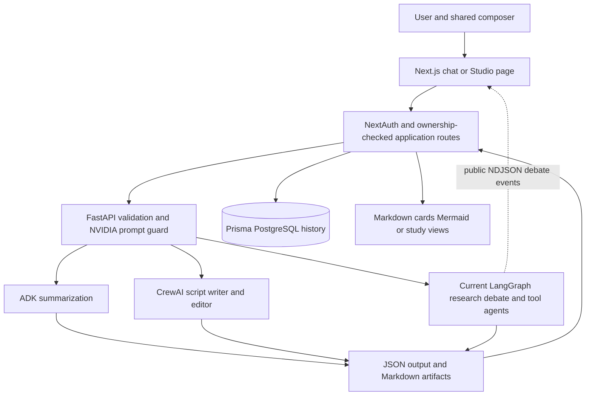
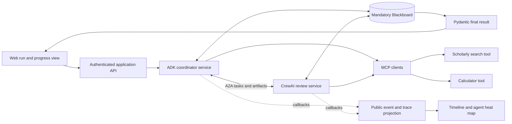
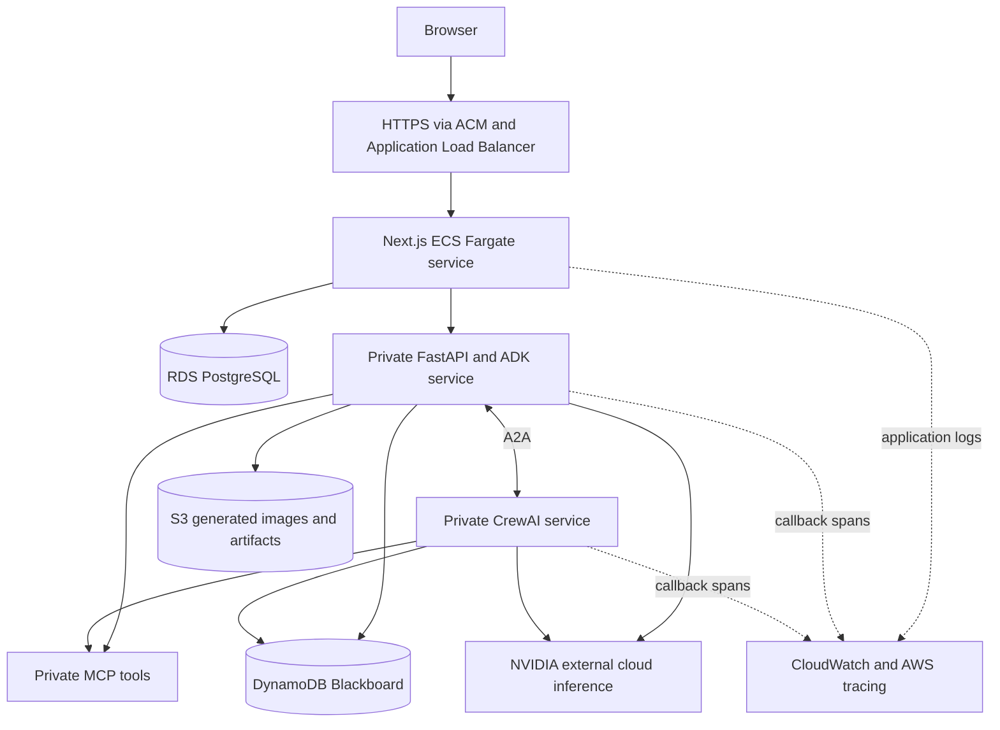

# SophiaNet Web — The Wisdom Network

SophiaNet is a learning and research workspace for source-linked chat, document questions, scholarly discovery, study material, scripts and diagrams. This repository contains the **Next.js frontend and authenticated application API**; a separate Python microservice runs the AI workflows.

**Deployment destination: AWS.** The deployment and assessment plans below are targets, not claims of an already deployed or fully compliant system. This README describes the web repository independently.

**Required agentic framework policy: CrewAI and Google ADK only.** Both are used in the backend today, but active LangGraph workflows remain and must be migrated before claiming compliance. The browser does not orchestrate agents or hold model credentials. Blackboard, MCP, cross-service A2A, callback tracing, heat maps and the controlled evaluation are partly or wholly pending below.

[Documentation index](docs/README.md) · [Literature review](docs/literature_review.md) · [Research collection](docs/research/README.md) · [Commands and safety](docs/chat_commands_and_safety.md) · [Tool state](docs/tool_session_state.md)

## Objectives and intended users

Students, educators and researchers need to connect scattered notes, lecture videos and papers, inspect evidence behind generated answers and turn it into useful learning material.

- **PS1 — Fragmented evidence:** bring supported source workflows into one accessible workspace.
- **PS2 — Unchecked generation:** expose drafting, criticism and final validation rather than presenting every output as verified.
- **PS3 — Limited transparency:** show public agent progress, failures and provenance without exposing private reasoning or secrets.
- **PS4 — Unproven quality/cost:** compare quality, response time and operating cost reproducibly.

Multiple agents are justified by distinct collection, writing and review responsibilities with explicit handoffs. The intended contribution is inspectable collaboration across educational workflows; superiority over existing products and improved learning outcomes have not been established.

## Available user workflows

| Feature | Current user experience | Boundary |
| --- | --- | --- |
| Chat and source attachments | Shared composer, microphone control, file selection, history and Markdown/code rendering | Browser permission and provider availability apply |
| Agent battleground | Streams Advocate, Critic and Judge contributions and saves the final answer | Role cards are transient, not A2A or a full audit trace |
| Research Paper Studio | Full-width workspace, two-column desktop cards, metadata, relevance and source links | AI relevance explanations do not establish full-text review |
| Learning Studio | Session brief, quiz carousel, flashcards, narration/code scripts and follow-ups | Schemas validate quizzes/cards; generated scripts are not executed |
| Notes and YouTube | Upload/OCR workflows and lecture transcript summaries | Input legibility and transcript availability affect results |
| Diagrams | Shared composer, Mermaid rendering, pan/zoom and export | Generated diagrams still require syntax/content validation |
| Tool state | User-scoped tab snapshots, reset controls and two-hour expiry | Files stay in memory; this is not the agent Blackboard |
| Generated images | Chat displays S3 URLs returned by the backend | No local/inline fallback; valid AWS credentials and live delivery qualification required |

The image-filter screen is not evidence of a completed image-filter agent. Cross-modal retrieval, generated videos and trend/sentiment dashboards are not claimed as implemented features.

### Slash commands on both chat entry points

Type `/` on `/chatbot` or an existing chat page. Arrow keys select; Enter/Tab inserts; Escape dismisses. Commands accept text only and reject attachments before sending.

| Command | Backend workflow | Displayed result |
| --- | --- | --- |
| `/agent-battleground <question>` | Three-role review | Public streamed contributions and saved final answer |
| `/summarize <source text>` | Google ADK editor | Markdown summary |
| `/research <question>` | Scholarly discovery/relevance selection | Up to five linked papers; question limited to 500 characters |
| `/quiz <topic>` | Structured study generation | Three questions and explained answers |
| `/flashcards <topic>` | Structured study generation | Five question/answer pairs |

Commands render in chat; dedicated interactive quiz/flashcard views live in Learning Studio. The browser sends a validated command identifier separately from plain content; Next.js forwards `command` and `prompt`, without a slash prefix. The landing page hands commands off to the new conversation page. Unknown/empty commands are rejected and failed requests restore the draft.

## Literature, products and agent requirements

Use this single summary table for the literature-review slide. The [ten-paper catalogue](docs/research/papers.json) preserves paper references and revisions. Product overlap does not establish that competitors lack SophiaNet's proposed mechanisms.

| Research or product | Foundation/capability | Gap or evaluation question | Requirement |
| --- | --- | --- | --- |
| [RAG](https://arxiv.org/abs/2005.11401), [Sentence-BERT](https://aclanthology.org/D19-1410/) | Retrieval and semantic evidence access | **G1:** show sources and measure answer support | R1, R2 |
| [ReAct](https://arxiv.org/abs/2210.03629), [Self-RAG](https://arxiv.org/abs/2310.11511) | Tool observations and critique | **G2:** expose handoffs and test specialist-review benefits | R2, R3 |
| [Tutor CoPilot](https://arxiv.org/abs/2410.03017) | Direct educational-outcome evaluation | **G3:** successful generation and attractive UI do not establish learning gains | R6 |
| [CLIP](https://proceedings.mlr.press/v139/radford21a.html), [BLIP](https://proceedings.mlr.press/v162/li22n.html), [latent diffusion](https://arxiv.org/abs/2112.10752), [Tesseract](https://research.google/pubs/an-overview-of-the-tesseract-ocr-engine/) | Pretrained media-processing foundations | **G4–G5:** evaluate media fidelity and educational artifact quality | R2, R6 |
| [Nemotron 3 Nano](https://arxiv.org/abs/2512.20848) | Model-family research context | **G6:** measure the actual hosted model rather than transferring paper benchmarks | R6 |
| [NotebookLM / Google education overview](https://services.google.com/fh/files/misc/notebooklm_gfe_one_pager.pdf), [Elicit workflows](https://support.elicit.com/en/articles/14757543-getting-started-with-elicit-which-workflow-should-i-use) | Source-grounded learning and research workflows | **G7–G8:** compare collaboration transparency and research relevance using evidence | R1, R3, R5, R6 |

| Requirement | Origin | Agent/system ownership and web responsibility |
| --- | --- | --- |
| **R1** — Attributable discovery | PS1, G1, G8 | ADK evidence worker; show sources, links and availability notices |
| **R2** — Grounded validated artifacts | PS2, G1–G5 | CrewAI writer/critic/finalizer and validators; render schema-backed results |
| **R3** — Explicit context handoffs | PS2–PS3, G2, G7 | ADK coordinator and workers; show consumed Blackboard versions |
| **R4** — Safe execution | PS2–PS3 | Backend guardrails/callbacks; validate commands and show safe rejection/retry states |
| **R5** — Interoperability/auditability | PS3, G7–G8 | ADK/CrewAI A2A services; link public progress to run/trace IDs |
| **R6** — Quality/cost evaluation | PS4, G3–G8 | Evaluation harness; present actual run records and comparison plots |

## Assessment coverage and remaining work

| # | Assessment requirement | Current evidence / required completion |
| --- | --- | --- |
| 1 | Blackboard and messaging comparison | Draft state and role streams exist. **Pending:** backend Blackboard and public context-handoff view; browser storage is not Blackboard |
| 2 | Two external tools through MCP | Research/source workflows exist. **Pending:** real MCP calls and identifiable tool events |
| 3 | Pydantic structured final output | Selected backend outputs are validated; web uses Zod and Markdown. **Pending:** universal Pydantic result contract |
| 4 | Sequential/hierarchical/parallel patterns | Current sequential role display exists. **Pending:** compliant ADK/CrewAI variants and architecture comparison |
| 5 | Callbacks and agent heat map | Public role progress and safe errors exist. **Pending:** callback-derived agent timings/error heat map |
| 6 | Cross-framework A2A | **Pending:** no ADK↔CrewAI protocol exchange; zero implemented A2A service participants |
| 7 | CrewAI + ADK only | Both exist, alongside LangGraph. **Pending:** backend migration; no extra browser agent framework |
| 8 | Guardrails and validation callbacks | Command validation, ownership checks and backend input filter exist. **Pending:** tool-return/source/output callbacks |
| 9 | Tracing/provenance | Paper links and final chat persistence exist. **Pending:** durable correlated run/trace/event linkage |
| 10 | Multiple-run quality/time/cost evaluation | **Current-system evaluation recorded:** 40 cases/120 live API attempts and [browser receipts](docs/evaluation/20261120/README.md). The balanced architecture comparison and full internal per-agent tracing remain pending |
| 11 | Cloud deployment | **Planned on AWS:** hosted app, real OAuth, streaming and isolation acceptance evidence |

## Current request flow



The diagram includes the framework migration gap. Most pages use authenticated application routes. The generic `/microservice/:path*` rewrite is not proof of authentication/ownership and must be secured or removed from public access before deployment. The Python API currently lacks service authentication. An authenticated UI does not secure every reachable backend path.

### MAS presentation target — not implemented

The backend target is a **hierarchical ADK coordinator with parallel independent evidence work and sequential CrewAI drafting/review**, using a mandatory run-scoped Blackboard. Compare sequential, parallel and hierarchical alternatives before declaring a winner. Use native ADK/CrewAI orchestration; ReAct-style prompting is a condition to evaluate, not another framework.

Two independently addressable A2A services are planned: ADK coordination/evidence and CrewAI writing/review. Both read and publish versioned Blackboard artifacts. At least two MCP tools are planned: scholarly lookup using Crossref/arXiv, and a bounded calculator. A2A delegates between agents, MCP invokes tools and the Blackboard holds context. See the [A2A specification](https://a2a-protocol.org/latest/), [ADK A2A guide](https://google.github.io/adk-docs/a2a/intro/) and [MCP documentation](https://modelcontextprotocol.io/docs/getting-started/intro).



Required handoff example: evidence worker publishes sources → writer consumes that version and writes a draft → critic consumes sources/draft and writes review → finalizer consumes review and publishes a validated answer. Preserve run/tenant/agent IDs, versions and evidence lineage. PostgreSQL chat history and browser snapshots are separate from the proposed DynamoDB/S3 Blackboard. The delivered system must retain Blackboard even if isolated experiments compare P2P artifact exchange.

A future progress UI should show task/run IDs, source citations, public drafts/critiques, validation outcomes, safe tool summaries, consumed state versions and failure states. These are proposed additions. Agent heat-map rows represent agents; columns represent phases/time buckets; colors represent measured duration/error counts, with numeric alternatives. Do not display hidden reasoning, secrets, unrestricted documents or fabricated activity.

The proposed final JSON contract contains run/status identifiers, Markdown answer, typed evidence/citations, artifact references, warnings and metrics. Pydantic validates publication in Python; matching TypeScript/Zod schemas validate display. Current task-specific JSON remains the implemented contract until this change is made.

## Security, callbacks and retained state

NextAuth handles Google sign-in; application routes check session ownership. Chat/tool chat save user and bot messages transactionally after successful generation, so blocked requests create no partial exchange. The UI preserves backend safety status/messages: 403 blocked, 503 screening unavailable, 413 oversized screening input.

The backend guard screens prompts, supplied history, topics, research queries and diagram code. It does not inspect attachments, retrieved content or generated output. Planned before/after agent/model/tool callbacks must validate tool-return types/sizes and source/output safety before publication. Synthetic personas should test toxic phrasing, overrides, malformed tool results and false blocking without real secrets.

Proposed audit events need run/task/trace/parent IDs, framework/agent, prompt-template version, protected input/output references or hashes, model/tool/source provenance, timing, usage, validation status and safe errors. Correlated spans and structured logs should feed AWS tracing/CloudWatch and the public UI projection. Existing role streams/file logs and installed telemetry dependencies are not a complete audit mechanism; CrewAI tracing is currently disabled.

Tool snapshots are user-scoped, tab-scoped and expire after two hours, with clear-current/clear-all controls. Files stay in memory. Database history, drafts and Blackboard state have different retention rules; browser clearing does not delete server audit records.

## AWS deployment design — planned



Use ECR images, ECS Fargate CPU services, private agent/tool networking, RDS for Prisma, DynamoDB for shared state, S3 for generated artifacts and Secrets Manager/task IAM roles for credentials/AWS access. Application compute is on AWS; NVIDIA inference remains external. AWS documents [Fargate networking](https://docs.aws.amazon.com/AmazonECS/latest/developerguide/fargate-task-networking.html), [secret injection](https://docs.aws.amazon.com/AmazonECS/latest/developerguide/secrets-envvar-secrets-manager.html) and [CloudWatch logging](https://docs.aws.amazon.com/AmazonECS/latest/developerguide/using_awslogs.html).

Before release:

1. Provision infrastructure, private discovery/authentication, TLS and security groups. Include outbound access for NVIDIA/public sources and budget NAT or suitable AWS endpoints. This README is not a deployed infrastructure definition.
2. Securely configure `NEXTAUTH_URL`, OAuth callback URL, `NEXTAUTH_SECRET`, Google credentials and RDS `DATABASE_URL`. Set server-only `MICROSERVICE_BASE_URL` to the private API. Keep NVIDIA/AWS secrets out of browser environment variables.
3. Apply reviewed Prisma migrations; verify backups, real login, per-user isolation and transactional persistence on RDS.
4. Secure/remove the generic rewrite, restrict backend CORS and authenticate internal services. Test stream buffering, cancellation, timeouts, retries and rate/resource limits.
5. Private S3 access needs a change from the current uploader's public-read default, plus authorized signed links and expired-link handling. Keep generated output S3-only. [AWS presigned access](https://docs.aws.amazon.com/AmazonS3/latest/userguide/ShareObjectPreSignedURL.html).
6. Measure local ML memory/startup/latency and isolate heavy image work if needed. Fargate is not a GPU runtime; GPU inference needs a supported choice such as ECS on GPU EC2. [AWS Fargate FAQ](https://aws.amazon.com/fargate/faqs/).
7. Record deployed URL/region/configuration, liveness/readiness, OAuth and ownership checks, streamed results, two MCP receipts, cross-framework A2A traces, Blackboard consumption, S3 upload/read and cost/runtime evidence.

The Next.js configuration currently ignores TypeScript/lint errors during builds; explicit checks and release-blocker resolution are necessary. Existing Dockerfiles/Compose references do not establish deployment, readiness or current-source parity.

## Validation and evaluation plan

The [current browser evaluation](docs/evaluation/20261120/README.md) records real summary handoff/persistence, invalid-command and guard rejection, reload, mobile keyboard behavior and six tool routes. Backend/scorer checks pass 62 tests; 120 live API attempts cover a 40-case suite. These are current-system receipts, not real OAuth login, complete accessibility, AWS acceptance or a completed architecture comparison.

The balanced architecture-comparison study remains **planned**: 40 labeled cases = **5 personas × 2 prompt structures × 4 task families**. Personas: novice, advanced learner, educator, time-constrained researcher and adversarial user. Structures: direct brief and ReAct-style action/observation instructions. Families: document questions, scholarly research, scripts and structured study artifacts. Include matched benign/synthetic attack variants with expected safety decisions.

Use the same cases for **3 architectures × 2 messaging patterns (Blackboard/P2P) = 240 end-to-end runs, 40 per configuration**. Only ADK/CrewAI orchestrate these variants. Blackboard remains mandatory in the delivered system. Freeze model, tools, evidence snapshots, budgets and rubrics; randomize ordering, tag cold/warm starts/concurrency and retain failures. Replicate a subset to distinguish stochastic variation from case variation.

Dataset records need exact prompts, persona/task IDs, template/source versions, reference answers, expected sources/schema/safety outcomes. Raw runs need outputs, agent/tool events, trace IDs, per-agent/system duration, first visible event, usage, retries, status and dated cost inputs. Judge correctness/citations against references/human rubrics; disclose any supplementary LLM judge and its agreement with reviewed cases. Unit counts, prompt overlap and self-ratings do not establish quality.

Planned results include latency/cost boxplots by architecture/messaging, sample counts, failure rates, agent-duration/error heat maps and case-level provenance. A separate current-system 40-case dataset, CSV/raw results and latency plots are now stored in the microservice repository. The balanced architecture/persona study, evaluation dashboard and architecture ranking remain incomplete. Screenshot evidence must come from real runs with environment, run/case ID and date.

Cost estimates include all model/guard/router/manager calls, token rates or explicit unknowns, tools, compute duration, idle services, ALB/NAT, RDS, storage and observability. Report cost per attempted/successful run and total study cost. Free inference quotas do not mean free AWS deployment; no dollar values or timing advantage are invented.

## Technology stack and structure

Next.js 15, React 19, TypeScript, Tailwind CSS 4, Motion, Mermaid, Markdown-it, syntax highlighting, NextAuth 4, Prisma 6/PostgreSQL, Zod, Axios and browser speech APIs power the web. The Python service uses FastAPI/Pydantic, CrewAI, ADK, NVIDIA and local ML/OCR tools; active LangGraph orchestration remains a migration gap under the required final stack.

```text
web/
├── src/app/chatbot/       # Landing, conversations and tool pages
├── src/app/api/           # Authentication, chat/debate, Studio and tool proxies
├── src/components/chat/   # Shared composer, commands and messages
├── src/components/tool/  # Learning, research and diagram interfaces
├── src/providers/        # Authentication and tool sessions
├── src/hooks/            # Files, speech and UI behavior
├── src/lib/              # Commands, validation, Markdown, Prisma and AI errors
├── prisma/               # Database schema/migrations
├── scripts/              # Command, state and system checks
└── docs/research/         # Research collection and provenance catalogue
```

Run from this repository:

```bash
npm ci
# Configure .env securely; preserve an existing working file.
npm run dev -- --port 3001
# Explicit checks; builds currently suppress some errors:
npx tsc --noEmit
node --experimental-strip-types scripts/check-chat-commands.mjs
node --experimental-strip-types scripts/check-tool-session.mjs
```

Configure `DATABASE_URL`, `NEXTAUTH_SECRET`, `NEXTAUTH_URL`, `GOOGLE_CLIENT_ID`, `GOOGLE_CLIENT_SECRET` and server-only `MICROSERVICE_BASE_URL` (default `http://localhost:8000`). Use a Node version supporting the checks' type-stripping flag. Full-repository lint has existing failures; resolve/report them before release. Start Python from the separate microservice folder with `./scripts/run.sh`; Python work uses Conda **`sophianet-venv`**.

## Presentation and report map

Team identities/enrollment numbers and completed individual contributions were not supplied. Populate these from actual evidence; the workstreams below imply neither a team size nor completed assignments.

| Workstream | Member name / enrollment | Contribution evidence |
| --- | --- | --- |
| UI/accessibility/state | Not supplied | Owned components and browser checks |
| Agent orchestration/Blackboard | Not supplied | ADK/CrewAI modules and handoff tests |
| MCP/A2A/security callbacks | Not supplied | Protocol traces and validation tests |
| Evaluation/observability | Not supplied | Dataset, raw runs, plots and traces |
| AWS/demo | Not supplied | Deployment configuration, acceptance checks and captures |

| Slide | Required content |
| --- | --- |
| 0 | Title and actual team names/enrollment numbers |
| 1 | Objectives/problem statement, PS1–PS4 |
| 2 | One literature/product table and gaps |
| 3 | R1–R6 mapped to problem/literature gaps and agents |
| 4 | End-to-end MAS, orchestration and chosen architecture |
| 5 | Architecture comparison with measured or explicitly heuristic rationale |
| 6 | MCP agent/tool diagram and two actual invocations |
| 7 | Blackboard/P2P communication and actual A2A service count |
| 8 | Guardrails, safeguards and validation callbacks |
| 9 | Dataset, personas, prompt/configuration coverage and run counts |
| 10 | Reference/human/LLM-judge results, per-agent/system time, cost and boxplots |
| 11 | Evidence-backed responsibility/self-contribution matrix |
| 12 | Real working-system screenshots with run/environment provenance |
| 13 | Supported outcomes, contributions and limitations |
| 14 | Paper/product/protocol/AWS references |

Report layout: **1 Introduction (p.1); 2 Problem Statement (pp.2–3); 3 Literature Review (pp.4–6); 4 Methodology (pp.8–16); 5 Technology Stack (p.17); 6 Experimental Results (pp.18–25); 7 Team Responsibility/Self-Contribution Matrix (p.26); 8 Conclusions (p.27)**. Methodology covers agent derivation, orchestration, messaging, MCP/A2A, security, validation and AWS diagrams. Results require actual outputs, snapshots, comparisons and failures; these page ranges describe the supplied layout, not completed slides/report or experiments.

The current outcome is an integrated local learning/research interface with explicit limitations. Required completion evidence is the CrewAI/ADK-only backend, real Blackboard/MCP/A2A interactions, callback observability, controlled experiments and an accepted AWS deployment. References are linked at claims and indexed in the [research collection](docs/research/README.md).

## Recorded evaluation

[Browser receipts, actual screenshots and API summary](docs/evaluation/20261120/README.md) accompany 120 live API attempts over 40 cases. The microservice repository holds the authoritative frozen inputs and raw results; this repository stores the web evidence and a generated comparison summary. Paced execution passed 36/40 task checks, while the initial two-worker run passed 42/80 under substantial quota failures. These are acceptance checks rather than general accuracy; unknown costs and untested quality dimensions remain explicit.
