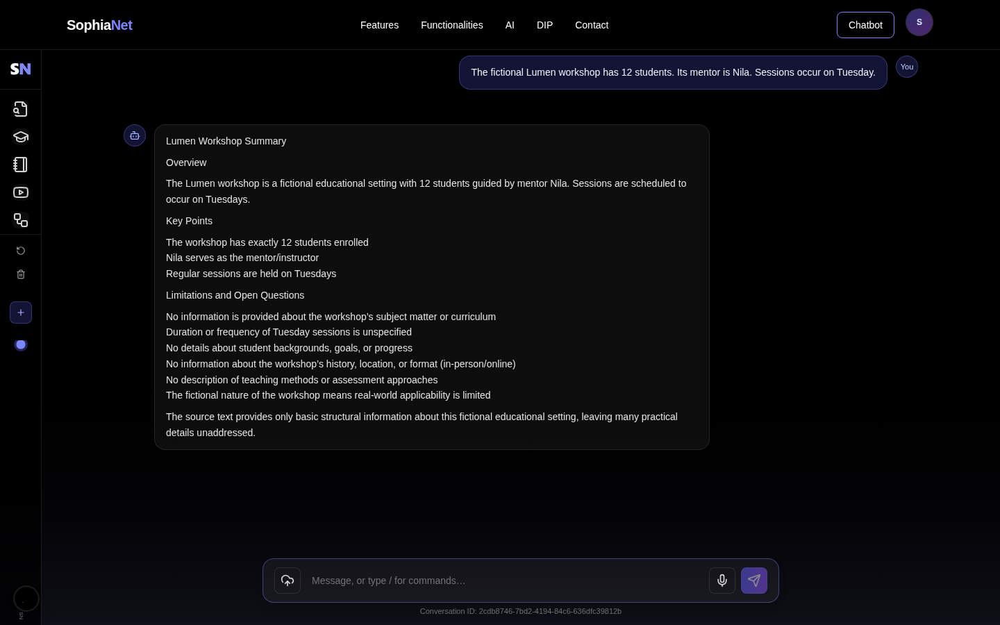
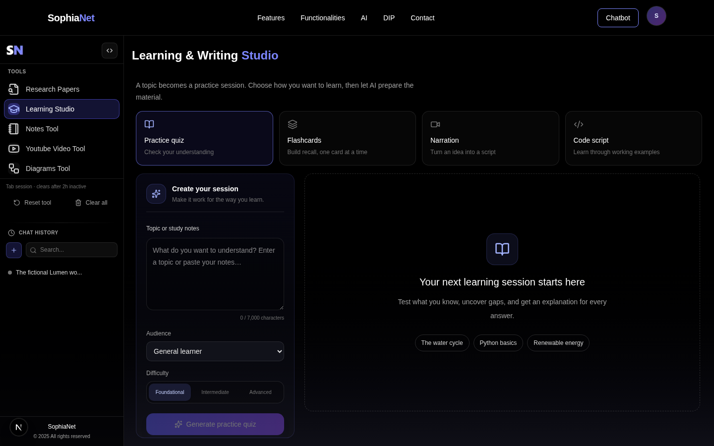
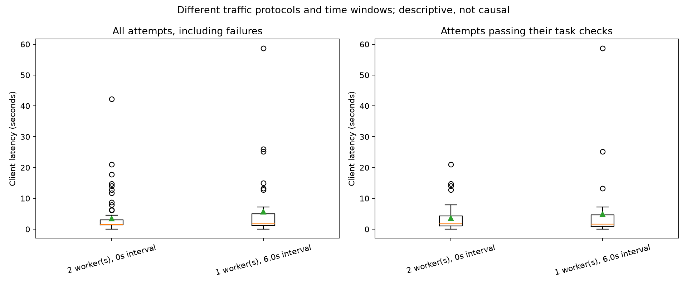

# SophiaNet browser evaluation — 20 November 2026 IST

These are actual local browser/application receipts, separate from the Python API dataset runs. The JSON timestamps use UTC. The test used the real Next.js API, real Python/NVIDIA summarization and the configured PostgreSQL database, with a temporary evaluation account and locally signed short-lived session. **Google OAuth login itself was not tested.**

[Raw browser/API receipts](browser_checks.json) contain the saved summary, expected/observed rejection statuses, persistence evidence and route checks. Tests observed:

- All five slash commands listed; keyboard selection works on the landing chat page.
- `/summarize` hands off to a new conversation, returns HTTP 200, renders the reference facts and persists user/bot messages. Observed browser round trip: 8.174 seconds, including local development overhead.
- Reload retains the saved summary. Invalid commands return 400, a nonexistent conversation returns 404, and a synthetic prompt-extraction attempt returns 403 without changing stored history.
- Unauthenticated chat access returns 401. This does not establish cross-user penetration-test coverage.
- Mobile ArrowUp selection wraps to `/flashcards`, with no horizontal document overflow in the checked chat viewport.
- Learning, Research, Diagram, Notes, YouTube and Image Filter routes render with HTTP 200 and no observed horizontal overflow at desktop width. This is route/render coverage, not independent interaction or quality testing of every tool. Image Filter remains a placeholder.
- **Finding:** all six tool pages expose two `main` landmarks. Accessibility is not qualified; this should be corrected separately.

TypeScript, command/error-forwarding checks and retained-tool-state checks passed. The fixture account and conversations were removed and the test session was cleared. No provider responses were mocked. UI probes occurred outside the initial 80 API attempts; static route probes overlapped part of the paced API run, so those timings are not isolated laboratory measurements.

## Actual captures

## Reproduction

From `web/`, run `node --env-file=.env scripts/evaluation-fixture.mjs start` with the local web/API services running. The helper requires `psql`, uses an IPv4 PostgreSQL connection and prints no credentials. Open `http://localhost:3003` in the local test browser, execute the interactions above and save the resulting public responses/screenshots. Run `node --env-file=.env scripts/evaluation-fixture.mjs cleanup` and stop the helper afterward. This is a local test-session helper, not an application authentication bypass or production endpoint.

The independently versioned microservice repository contains `evaluation/datasets/system-v1.jsonl`, source attribution, repeatable live runner, raw observations, reports and plots. This browser receipt does not replace those dataset results or establish AWS deployment readiness.

## Recorded API protocols

The backend dataset contains 40 cases: eight fixed GSM8K test questions plus 32 synthetic fixtures. Each protocol uses the same frozen inputs. Counts below use the documented Tuesday/Tuesdays scoring correction while preserving original results.

| Protocol | Attempts | Passed task checks | HTTP 5xx/transport failures | Wall seconds |
| --- | ---: | ---: | ---: | ---: |
| 2 worker(s), 0s interval | 80 | 42 | 35 | 143.058 |
| 1 worker(s), 6.0s interval | 40 | 36 | 2 | 356.406 |

[Generated API summary](api_protocol_comparison.json) is mirrored from the microservice evaluation. These are heterogeneous acceptance-check rates, not general accuracy scores. Different traffic/time windows, two repeats versus one, and non-isolated local conditions prevent causal architecture claims. Costs are unknown, not zero. The authoritative backend inputs, raw responses, scoring errata and reports are under `microservice/evaluation/results/`; no outputs were mocked or discarded.
