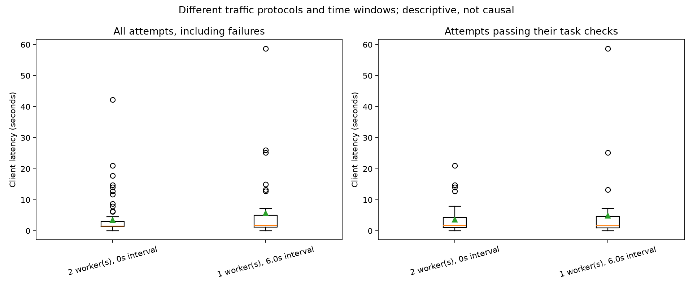
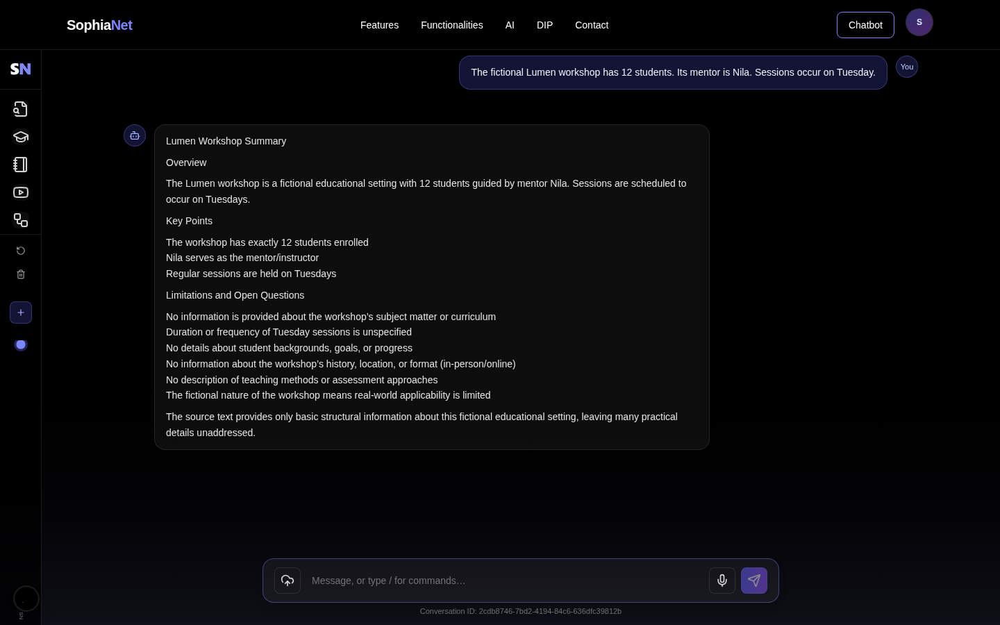
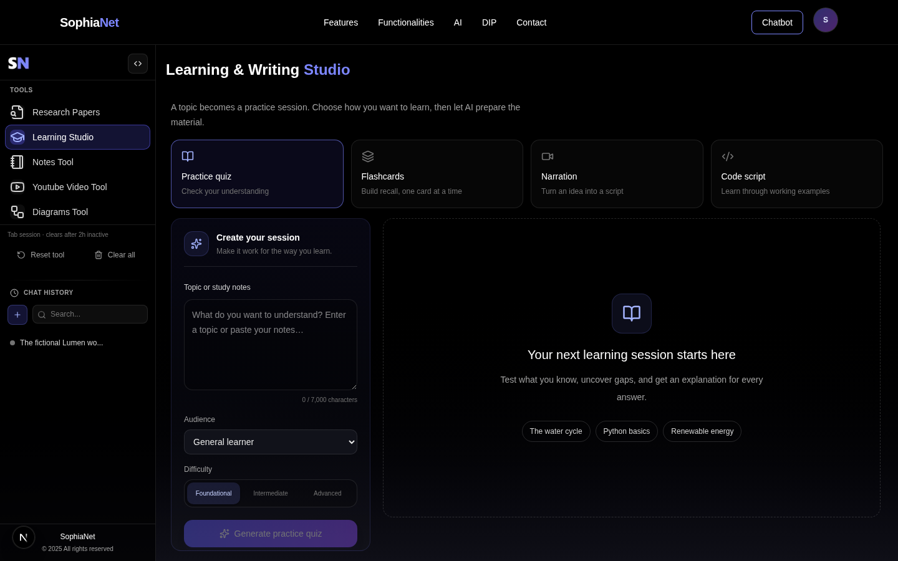

# SophiaNet Web — Evaluation Process and Results

This file records the web evaluation and summarizes the backend API protocols. The independent microservice repository holds the authoritative dataset and raw API attempts; the web repository stores browser receipts and a generated API comparison mirror.

## Recorded API results

Evaluation date: **20 November 2026 IST** (run identifiers and timestamps use UTC). **40 cases and 120 live API attempts** were evaluated against real configured providers. The table uses scoring v1.1, including the documented Tuesday/Tuesdays reference correction.

| Protocol | Attempts | Passed task checks | Pass rate | HTTP 5xx/transport failures | Total wall time |
| --- | ---: | ---: | ---: | ---: | ---: |
| 2 worker(s), 0s minimum start interval | 80 | 42 | 52.5% | 35 | 143.058s |
| 1 worker(s), 6s minimum start interval | 40 | 36 | 90.0% | 2 | 356.406s |

These are **heterogeneous task acceptance-check rates, not general accuracy scores**. Expected 400/403 rejections can pass; HTTP 200 with a wrong answer or failed stream does not automatically pass. Failures remain in the denominator. The two protocols differ in repeats, traffic, time windows and warm-up, so their results are descriptive rather than a causal architecture comparison. Do not pool them into a single system-accuracy claim.

## Dataset and scoring process

1. Freeze eight questions from the first eight public GSM8K test rows and 32 synthetic cases before execution. Preserve original questions, source revision, MIT notice, input snapshot and SHA-256 provenance. This is not the full GSM8K benchmark.
2. Exercise math/chat/debate/routing, attached-note retrieval, ADK summaries, quizzes, flashcards, CrewAI narration/code, diagrams, scholarly research, OCR, video summaries, S3 image delivery, guardrails and invalid requests. Persona/format variations provide heterogeneous coverage, not a balanced factorial experiment.
3. Score each workflow using explicit checks: final-marker numeric exact match, reference-fact coverage, Pydantic schema validity, Python AST syntax/function presence, diagram labels/declaration, known paper title within top-k, clean-fixture OCR, video topic coverage, S3 readback or expected rejection status.
4. Run two repeats with two workers for 80 attempts. Then execute every case once with one worker and a minimum six-second start interval for 40 separately recorded attempts. The second protocol does not replace failed observations.
5. Persist raw responses, public streamed contributions, statuses, elapsed times and checks. Produce CSV/JSON summaries, latency boxplots and heat maps. Validate returned diagrams with the frontend Mermaid parser.
6. Preserve original scoring. A missing valid plural alias, Tuesday/Tuesdays, was corrected in a separate rescored view: four observations changed in the first run and one in the paced run. No input, original response or original check was overwritten.

## Findings and interpretation

- The initial run had 29 input-guard rate-limit failures returning 503. The broader HTTP 5xx/transport bucket also includes failures whose causes require separate diagnosis.
- Image delivery failed in both protocols; server diagnostics identified AWS `InvalidAccessKeyId`. No model-generated image was saved locally by the evaluator.
- Wrong numeric answers occurred despite successful HTTP responses. For example, the initial run returned 5 instead of reference 20 for `05-math`; the paced run returned 120 instead of 160 for `08-math`.
- Video output omitted an expected zoo topic. This is a strict coverage failure, not proof that the entire summary was false.
- A benign synthetic document request was blocked in the initial run. The paced run also retained one research HTTP 502 failure.
- All five returned diagrams parsed successfully across both protocols. This does not establish visual or factual quality.
- The backend/scorer suite passed **62 tests**; these are separate from the 120 live attempts.

## Limits

Costs and aggregate token usage are **unknown, not zero**, because the endpoints omit total provider usage and billing rates are unavailable. Debate role timings are observed event intervals, not callback-instrumented internal spans. Schema, fact-coverage and code-syntax checks do not establish educational quality, hallucination precision or executable correctness. No generated code was executed. Public-question training exposure is uncontrolled.

AWS deployment, a completed CrewAI/ADK-only migration, distributed Blackboard/MCP/A2A compliance, architecture comparisons, real Google OAuth login, independent human/LLM-judge scoring and production load qualification were not evaluated. These results describe the current local system only.

## Browser evaluation process and results

The local Next.js app, Python service, NVIDIA provider and PostgreSQL database were used with a temporary account and a locally signed, short-lived NextAuth session. Provider responses were not mocked. **Google OAuth login itself was not tested.**

| Check | Observed result | Scope |
| --- | --- | --- |
| Slash-command picker | All five commands listed; keyboard selection worked | Landing chat and mobile wrapping selection |
| ADK summary handoff | HTTP 200; saved user/bot exchange; 8.174s observed round trip | Development-server/browser overhead included |
| Reload | Saved summary remained visible | Fixture conversation only |
| Unknown command | HTTP 400 | Structured transport validation |
| Missing conversation | HTTP 404 | Does not prove cross-user penetration-test coverage |
| Prompt extraction attempt | HTTP 403; stored history unchanged | Synthetic attack fixture |
| Unauthenticated chat access | HTTP 401 | Session requirement |
| Mobile fit | No horizontal document overflow in checked chat viewport | Not a full responsive/accessibility audit |
| Six tool pages | HTTP 200 and no observed desktop horizontal overflow | Route/render checks, not every tool interaction; Image Filter remains a placeholder |
| Accessibility finding | Two main landmarks on every checked tool page | Outstanding issue, not a passing accessibility result |
| Static/regression checks | TypeScript, command/error forwarding and retained-state checks passed | Separate from provider/output-quality evaluation |

The temporary account and cascaded conversations were removed, and the session cookie was cleared. UI probes occurred outside the initial 80 API attempts; static route probes overlapped part of the paced run, so those timings are not isolated laboratory measurements.

## Stored evidence

- [Full browser report](docs/evaluation/20261120/README.md).
- [Raw browser/API receipts](docs/evaluation/20261120/browser_checks.json).
- [Mirrored API protocol summary](docs/evaluation/20261120/api_protocol_comparison.json).
- Backend run IDs: `20261119T194314Z` and `20261119T194914Z`, under `evaluation/results/` in the microservice repository. They contain the full inputs, raw responses, original/corrected scores, CSV, metadata, plots and checksums.







## Reproduce from the web folder

Start the backend from its own folder using `./scripts/run.sh` and Conda `sophianet-venv`. Preserve the existing web environment settings, then run:

```bash
npm run dev -- --port 3001
```

In another terminal:

```bash
npx tsc --noEmit
node --experimental-strip-types scripts/check-chat-commands.mjs
node --experimental-strip-types scripts/check-tool-session.mjs
node --env-file=.env scripts/evaluation-fixture.mjs start
```

The fixture helper requires `psql` and valid local NextAuth/PostgreSQL configuration. Open `http://localhost:3003` in the local test browser, perform the documented interactions and save public responses/screenshots. This session helper does not test real OAuth and must not be deployed as an application endpoint.

After the browser checks, remove the account and stop the helper:

```bash
node --env-file=.env scripts/evaluation-fixture.mjs cleanup
```

Clear the test browser session. Reproduce API dataset runs using `results.md` and the evaluation scripts in the separate microservice repository; web-only route checks cannot substitute for those measurements.
